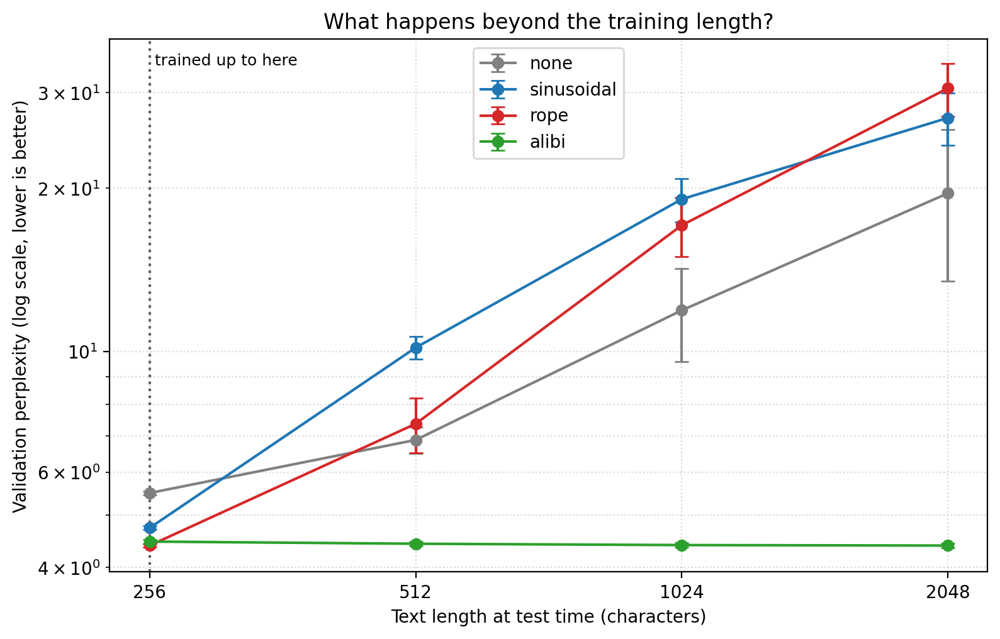

# rope_playground: breaking down attention (0_o)

ever wondered how AI models like GPT, Llama, or Claude actually understand the *order* of words? 

i built this repo as a learning canvas to figure it out from scratch. no dense academic math jargon—just pure python, pytorch, and interactive sandboxes where you can actually watch the tensors move. whether you're an AI student or just someone trying to peek under the hood of LLMs, this project simplifies the core mechanics of Multi-Head Attention and Rotary Position Embeddings (RoPE).

---

## [?] the learning canvas (how it works in simple terms)

before diving into the code, here is the ultimate cheat sheet for how transformers actually read.

### 1. the networking event (Q, K, V)
when a word enters the model, it splits into three parts. imagine words at a crowded networking event:
* **Query (Q):** what the word is looking for. (e.g., "bank" holds up a sign saying: *"i need words about money or rivers to know what i mean."*)
* **Key (K):** what the word is advertising. (e.g., "river" holds up a sign: *"i am a body of water."*)
* **Value (V):** the actual core meaning of the word that gets passed along if a match is made.

### 2. self-attention (the matchmaker)
instead of reading left-to-right like old AI, a transformer compares every single word's **Query** against every other word's **Key** simultaneously. if the math (dot product) scores a high match, the words blend their **Values** together. this is how "bank" realizes it means a riverbank instead of a financial institution.

### 3. the "bag of words" problem
here's the catch: because attention compares everything all at once, it has zero concept of time or order. to the math, *"the dog bit the man"* and *"the man bit the dog"* look exactly the same. if we don't fix this, the AI is essentially reading a book where all the pages are ripped out and scattered on the floor.

### 4. the old fix (vaswani sinusoidal waves)
the original 2017 transformer paper fixed this by adding sine and cosine waves directly to the words. think of it like stamping a unique mathematical wave pattern (or a page number) onto every scattered page. it works, but it's hard for the model to naturally learn the *relative* distance between words.

### 5. the modern revolution (RoPE)
modern models (llama, mistral) use **Rotary Position Embeddings (RoPE)**. instead of *adding* numbers, RoPE *rotates* the word's vector in 2D space. 
* imagine every word is a clock hand. a word at position 1 ticks forward once. position 5 ticks forward five times. 
* **the magic:** if "eat" is at pos 2 and "apple" is at pos 5, they are 3 ticks apart. if they appear later at pos 102 and 105, they are *still* 3 ticks apart. when the model compares their angles, it instantly knows their relative distance. as words get further apart, their clock hands naturally fall out of phase, and their attention score smoothly decays. closer words matter more, entirely for free!

---

## >_ what's inside (play with it)

i built this to be experimented with. clone it, break it, print the shapes.

* **`positional_encodings.py`** — the actual math for generating sinusoidal waves and RoPE 2D complex rotations (run it directly for an interactive terminal demo!).
* **`attention.py`** — building custom Multi-Head Attention ($Q, K, V$ projections and causal masking) completely from scratch.
* **`sandbox/play_custom_attention.py`** — a step-by-step trace of how a sentence splits across different attention heads.
* **`sandbox/inspect_bert_heads.py`** — peek at which word each head of a real BERT model focuses on (needs `pip install transformers`).
* **`experiment.py`** — measures RoPE's long-term decay and saves the plot to `assets/decay_plot.png`.
* **`model.py`, `data.py`, `train.py`** — a tiny GPT (~0.8M parameters) that reads Tiny Shakespeare one character at a time, plus its data and training loop.
* **`study.py`** — the actual final boss. trains that GPT with 4 different ways of handling position and checks what happens when the text gets longer than anything it trained on (see below).
* **`extend.py`** — session 3: tries Position Interpolation, NTK scaling and YaRN, the tricks real LLMs use to stretch RoPE to longer texts (results coming).
* **`tests/`** — 111 checks that the math is actually right.

---

## =>> quick start

spin it up locally in a few seconds:

```bash
# clone the repo
git clone https://github.com/namita-tj/rope_playground.git
cd rope_playground

# setup virtual environment
python3 -m venv .venv
source .venv/bin/activate  # on windows: .venv\Scripts\Activate.ps1

# install dependencies
pip install -r requirements.txt

# run the experiment and the tests
python experiment.py
pytest
python study.py --quick   # mini version of the GPT study, ~1 min on a laptop
```

---

## \_(o_o)_/ the decay experiment

the RoPE paper promises *long-term decay*: words further apart should matter less. but there's a catch i fell into in the first version of this experiment — **decay only shows up for words that are actually related**. two random, unrelated words already score about 0 at every distance, so there's nothing to decay (my old plot was just noise!).

so `experiment.py` now measures two things, averaged over 1000 random words:

* **same word:** a word compared with *itself* placed d tokens away. without position info this is always 1.0.
* **unrelated words:** two independent random words d tokens apart.


| | distance 0–7 | distance 449–512 |
| :--- | ---: | ---: |
| RoPE, same word | 0.83 | 0.23 |
| RoPE, unrelated words | ~0.00 | ~0.00 |

the same word loses about 70% of its score over 500 tokens: closer copies matter more, exactly as promised. the wiggles come from the fast-spinning clock hands drifting in and out of phase.

---

## (>_<) the GPT experiment: what happens with longer text?

the decay plot is nice, but it's toy vectors. i wanted to see what actually happens inside a real (tiny) language model. so i trained the same little GPT four times on Tiny Shakespeare, changing only how it knows where each character sits:

* **none**: no position info at all. only the causal mask (you can't peek at future characters) hints at order.
* **sinusoidal**: the 2017 waves, added once to the input.
* **RoPE**: the clock hands from above, inside every attention layer (what llama uses).
* **ALiBi**: no positions at all, just a penalty on attention that grows with distance (what BLOOM uses).

every model trained on 256-character snippets. then i tested each one on text 2x, 4x and 8x longer than it had ever seen. 3 seeds each, so 12 training runs on a free colab GPU (about 3 min each).



perplexity is roughly "how many characters is the model torn between" (lower is better):

| method | 256 (trained) | 512 (2x) | 1024 (4x) | 2048 (8x) |
| :--- | ---: | ---: | ---: | ---: |
| none | 5.49 | 6.88 | 11.91 | 19.58 |
| sinusoidal | 4.73 | 10.17 | 19.09 | 26.96 |
| RoPE | **4.39** | 7.36 | 17.09 | 30.56 |
| ALiBi | 4.47 | **4.43** | **4.40** | **4.39** |

averages over 3 seeds. the spread is tiny at the training length (±0.03–0.04) and grows for the methods that break down. full numbers in [`results/summary.md`](results/summary.md).

what i had predicted, and what actually happened:

* **"RoPE ≥ sinusoidal > none at the training length"**: yes. RoPE is the best reader on text the length it trained on, ALiBi is right behind it, and having no position info at all costs the most.
* **"everything gets worse beyond the training length, ALiBi the least"**: half wrong, in a good way. ALiBi doesn't get worse at all. it gets very slightly *better* with more context. RoPE, the best model at 256 characters, falls apart the hardest: almost 7x worse at 8x the length.
* **the surprise**: the model with *no* position info degrades less than both sinusoidal and RoPE (3.6x vs 5.7x and 7x). my guess: it never learned to depend on exact positions, so it has less to lose when they go out of range. but its results also jump around a lot between seeds, so i wouldn't lean on that too hard.

this is exactly why real models can't just be run on longer text than they trained on. the next step (session 3) is to try the tricks that llama and qwen use to stretch RoPE to longer contexts (position interpolation, NTK scaling and YaRN) and see how much of that damage they undo.

one thing i learned the hard way: in my first version, sinusoidal looked terrible (perplexity ~28 vs ~11 in a quick check). it wasn't the method. the waves were way louder than the word vectors (up to 50x) and drowned them out. i tested three ways of scaling them, picked the one that trained best, and used the same setup for every method. one scaling detail changed the result by almost 3x, which is a good reminder to check the setup before trusting a comparison.

## [v] is the math actually right?

`pytest` runs 111 checks, including:

* **RoPE's defining property:** the score between positions *m* and *n* only depends on *m − n* (shift both by 1000 and nothing changes).
* **rotation keeps vector length** — spinning never stretches a word.
* **matches two independent references:** the complex-number formula `x · e^(i·m·θ)` and Hugging Face Llama's `rotate_half` formula.
* **my attention == PyTorch's built-in `scaled_dot_product_attention`**, with and without RoPE and causal masking.
* **the causal mask really hides the future:** changing the last word never changes earlier outputs.
* **order matters only with position info:** with no encoding, shuffling the words just shuffles the output.
* **any sentence length works** (an early version of `attention.py` crashed unless the sentence was exactly 2048 tokens — now there's a test so it can't come back).

CI runs all of this on every push.

