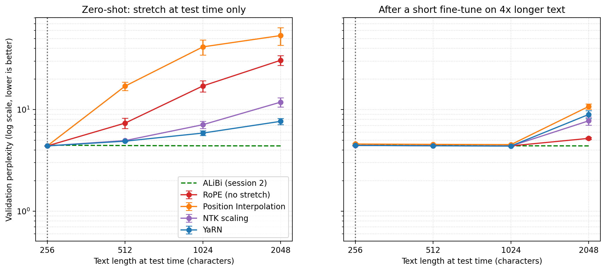

<div align="center">

# 🌀 rope_playground

**Attention and RoPE built from scratch in PyTorch, and what happens when a tiny GPT reads text longer than it was trained on** ♡

<a href="https://github.com/namita-tj/rope_playground/actions/workflows/test.yml"></a>


[What it is](#-what-it-is) · [Why](#-why) · [Results](#-results) · [Quick start](#-quick-start) · [How it works](#-how-it-works) · [Is the math right?](#-is-the-math-right) · [Files](#-where-to-find-what)

</div>

### 🤔 What it is
A learning project and a small research study in one. I built multi-head attention, sinusoidal encodings, RoPE and
ALiBi myself, trained a tiny GPT (about 0.8M parameters, Tiny Shakespeare, one character at a time) with each of
them, and tested what happens on text 2, 4 and 8 times longer than it trained on. Then I tried the three tricks
real LLMs use to stretch RoPE: Position Interpolation, NTK scaling and YaRN.

**For:** anyone who wants to see how transformers know the order of words, without the dense maths, and anyone
curious how LLMs get longer context windows.

### ✨ Why
Attention compares every word with every other word at once, so on its own it has no idea of order: *"the dog bit
the man"* and *"the man bit the dog"* look the same. Position encodings fix that, and most modern LLMs (Llama,
Mistral, Qwen) use RoPE.

**Why this matters:** a model only works well up to the text length it was trained on. Past that, it breaks. That
limit decides whether a model can read a whole contract, a codebase or a long conversation, and training a big model
again on longer text is very expensive. So the industry stretches existing models instead. I didn't want to just read
the papers: I wanted to build it, break it and measure it myself.

### 📈 Results
Perplexity is roughly "how many characters is the model torn between" (lower is better). Averages over 3 seeds.

**1. Four ways to handle position, trained on 256 characters:**

| Method | 256 (trained) | 2048 (8× longer) |
| --- | ---: | ---: |
| No position info | 5.49 | 19.58 |
| Sinusoidal (2017 original) | 4.73 | 26.96 |
| RoPE (Llama) | **4.39** | 30.56 |
| ALiBi (BLOOM) | 4.47 | **4.39** |

**2. Stretching RoPE without extra training, at 8× the length:**

| Method | 2048 (8× longer) |
| --- | ---: |
| RoPE, no stretch | 30.56 |
| Position Interpolation | 53.50 |
| NTK scaling | 11.84 |
| **YaRN** | **7.66** |

**In short:**
- RoPE is the best reader at the training length, and the one that falls apart the most beyond it (7× worse).
- ALiBi doesn't get worse at all on longer text.
- YaRN undoes 88% of RoPE's breakdown with no extra training. Position Interpolation alone makes it *worse*.
- After a short fine-tune on longer text, every method is back to about 4.4 at 4×. Training matters more than the trick.

All lengths, standard deviations and the fine-tuned results are in [`results/summary.md`](results/summary.md) and
[`results/extension/summary.md`](results/extension/summary.md).

<p align="center"> </p>

### 🚀 Quick start
Needs Python 3.11 or newer. Everything runs on a laptop CPU in quick mode.

```bash
git clone https://github.com/namita-tj/rope_playground.git && cd rope_playground
python -m venv .venv
source .venv/bin/activate          # Windows: .venv\Scripts\Activate.ps1
pip install -r requirements.txt

python positional_encodings.py     # interactive demo of the encodings in the terminal
python experiment.py               # RoPE's distance decay, saves assets/decay_plot.png
python study.py --quick            # mini version of the GPT study, about 1 minute
python extend.py --quick           # mini version of the stretching study
pytest                             # 111 checks that the maths is right
```

The full studies (`python study.py`, `python extend.py`) take about 40 and 30 minutes on a free Colab T4 GPU.

### 🔧 How it works
Each method gives the model a different way to know where a word is:

| Method | What it does | Used in |
| --- | --- | --- |
| Sinusoidal | Adds a wave pattern (like a page number) to each word, once at the input | The 2017 Transformer |
| RoPE | Rotates each word's vector by its position, inside every attention layer | Llama, Mistral, Qwen |
| ALiBi | No positions, just a penalty on attention that grows with distance | BLOOM, MPT |
| Position Interpolation | Slows every RoPE rotation down, so long text looks like short text | Extending Llama |
| NTK scaling | Slows only the slow rotations, keeps the fast ones for local detail | Code Llama |
| YaRN | Decides per rotation, and sharpens attention a little | Qwen, DeepSeek |

<details>
<summary><b>💡 The simple version: attention as a networking event, RoPE as clock hands</b></summary>

**Query, key, value.** Imagine words at a networking event. The **query** is what a word is looking for ("bank"
holds a sign: *I need words about money or rivers*). The **key** is what a word advertises ("river": *I am a body of
water*). The **value** is the meaning that gets passed on when there's a match.

**Self-attention** compares every word's query with every other word's key, all at once. A high match means the
words blend their values, which is how "bank" learns it means a riverbank. But because everything happens at once,
order is lost, like a book with its pages scattered on the floor.

**RoPE** turns every word into a clock hand. A word at position 1 ticks forward once, at position 5 five times. If
"eat" is at 2 and "apple" at 5, they are 3 ticks apart, and at 102 and 105 they are *still* 3 ticks apart. So the
model sees the distance between words, not their absolute place. Far-apart words fall out of phase, so their
attention fades: closer words matter more, for free.

**Why it breaks on longer text:** the slow hands reach angles the model never saw in training. The stretching tricks
slow the clock down so those angles look familiar again.

</details>

### 🧪 Is the math right?
`pytest` runs 111 checks, and CI runs them on every push. Among them:
- **RoPE's key property:** the score between positions *m* and *n* depends only on *m − n*.
- **Rotation keeps vector length**, so spinning never stretches a word.
- **Matches two independent references:** the complex-number formula and Hugging Face Llama's `rotate_half`.
- **My attention equals PyTorch's built-in `scaled_dot_product_attention`**, with and without RoPE and masking.
- **The causal mask hides the future:** changing the last word never changes earlier outputs.

### ✅ What it can and can't tell you
| Shows | Doesn't show |
| --- | --- |
| How each method behaves, measured on the same model and data | How a large LLM behaves: this is a 0.8M-parameter, character-level model |
| The pattern across 3 seeds, with standard deviations | Other data: everything trained on Tiny Shakespeare only |
| Zero-shot and fine-tuned stretching | Fine-tuning at 8×, or "dynamic" scaling that picks the factor from the text length |

### 💡 What I learned
- **Check the setup before trusting a comparison.** Sinusoidal first looked terrible: the waves were up to 50× louder than the word vectors. One scaling fix changed the result by almost 3×.
- **Smoke tests catch bugs, not conclusions.** A quick CPU check said YaRN made things worse. On the real model it's the clear winner.
- **Measure the right thing.** RoPE's decay only shows up for related words. Unrelated words score about 0 at every distance, so my first decay plot was just noise.
- **The best reader isn't the most robust one.** RoPE wins at the training length and loses the most beyond it.

### 📚 Where to find what
| I want to… | Look here |
| --- | --- |
| read the encodings (sinusoidal, RoPE, ALiBi, PI, NTK, YaRN) | `positional_encodings.py` |
| read attention built from scratch | `attention.py` |
| see the tiny GPT, its data and training | `model.py`, `data.py`, `train.py` |
| run the studies | `study.py` (4 methods), `extend.py` (stretching), `experiment.py` (decay) |
| play step by step, or peek into real BERT heads | `sandbox/` |
| see every number | `results/` |

### 🌱 What's next
Fine-tuning with the stretch factor matched to the test length (8×), and dynamic scaling, which most inference
libraries use.

<div align="center"><sub>build cool things that actually work ♡</sub></div>
